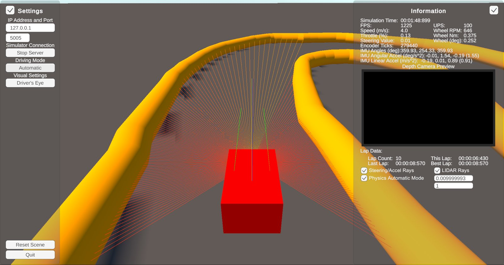
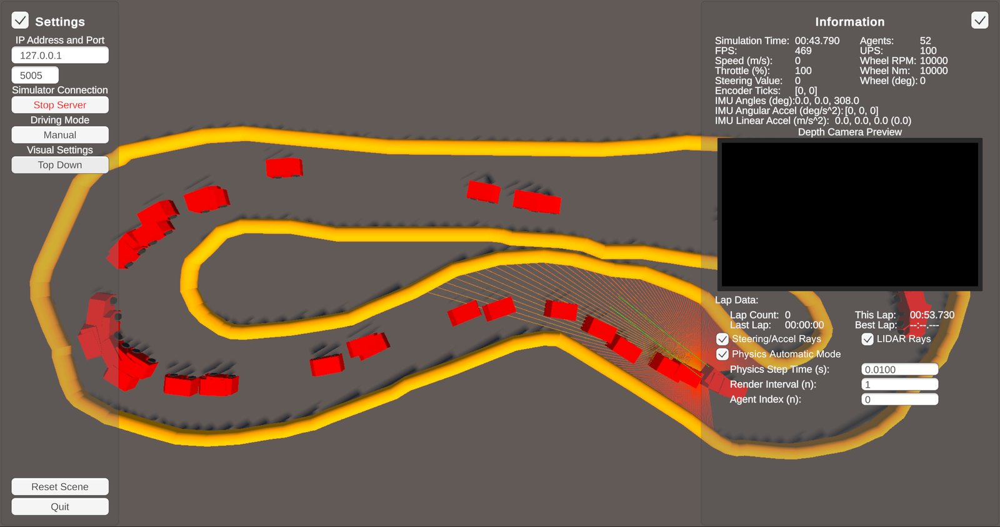

# UCI-F1Tenth-Unity-Simulator

A modernized and simplified rewrite of the [AutoDRIVE](https://github.com/Tinker-Twins/AutoDRIVE) simulator for UCI F1-Tenth,
built for reinforcement learning. It streams each car's LiDAR, IMU and wheel data to Python over a binary TCP protocol,
and can either run in real time or step the physics only when Python sends a command, so training isn't limited by real time.
The multi-agent scene runs 52 cars on the track at once.

This repo is one half of a pair:

- **UCI-F1Tenth-Unity-Simulator** (this repo): the Unity simulator.
- **[UCI-F1Tenth-Unity-Simulator-Bridge](https://github.com/uci-f1tenth/UCI-F1Tenth-Unity-Simulator-Bridge)**: the Python
  side, with the TCP bridge, a follow-the-gap controller, PPO training scripts and trained models.

It replaces the club's earlier [AutoDRIVE-UCI-V3](https://github.com/uci-f1tenth/AutoDRIVE-UCI-V3), which uses Socket.IO.





## Install

Download a build from [Releases](https://github.com/uci-f1tenth/UCI-F1Tenth-Unity-Simulator/releases/latest).
There is one build per scene:

- `UCI-F1Tenth-Sim-SingleAgent-Windows.zip`: one car.
- `UCI-F1Tenth-Sim-MultiAgent-Windows.zip`: 52 cars, for training.

Unzip and run `UCI-F1Tenth-Sim.exe`.

To run from source instead, install Unity **6000.3.8f1** through [Unity Hub](https://unity.com/download), add the cloned
folder in Unity Hub, open `Assets/Scenes/Single Agent/Single Agent Porto.unity` or
`Assets/Scenes/Multi-Agent/Multi-Agent Porto.unity` and press Play.

## Run

1. Start the simulator and click **Connect**. It starts a TCP server on the port shown (5005 by default).
2. Start a Python script from the bridge repo, for example the follow-the-gap controller:
   ```
   uv run TraditionalAlgos/FollowTheGap.py
   ```
3. In the single-agent scene, click **Driving Mode** to switch from **Manual** to **Automatic** so Python drives the car.
   The multi-agent scene takes commands from Python as soon as it connects.

## Use

- **Driving Mode:** Manual drives with WASD, Automatic takes steering and throttle from Python.
- **Physics Automatic Mode:** checked runs physics in real time. Unchecked steps the physics once per command from
  Python (by **Physics Step Time**), which is how the training scripts run.
- **Visual Settings:** cycles the camera (driver's eye, rear chase, bird's eye, top down).
- **Agent Index:** in the multi-agent scene, which car the info panel and camera follow.
- **Reset Scene** puts every car back at the start.

Crashing into a wall teleports the car back to its last checkpoint with a reward penalty. Checkpoints must be passed
in order for a lap to count.

### Protocol

All values are little-endian. For a single car, each telemetry packet is an 88-byte header followed by the LiDAR scan:

- Header (`<I6fif9ff3i`): sequence ID, sim time, time step, speed, steering, steering angle, throttle, wheel ticks,
  wheel RPM, IMU angles, linear acceleration, angular acceleration, reward, lap count, crashed flag, LiDAR count.
- LiDAR: `uint16` ranges scaled to 0-20 m. The single-agent scan has 180 points over 270 degrees, from left to right.

Commands are two `float32` values, steering then throttle, each from -1 to 1. The multi-agent scene sends one header
plus one block per car, and takes one steering/throttle pair per car. See `UnityBridge.py` and `MAUnityBridge.py` in the
bridge repo for the exact layouts.

## Branches

`main` has both scenes. `multi-agent` is where the multi-agent scene was developed.
